<div align="center">

# proxy2model

**Captured proxy traffic in, an evidence-backed model of the web app out.**

Hosts, pages, scripts, endpoints, parameters, auth and the gaps in what you captured,
each tied to the request that proves it. Secrets are masked before anything is written.

[](LICENSE)
[](https://github.com/falc0n-researcher/proxy2model/actions/workflows/ci.yml)
[](#boundaries)



</div>

## Install

```bash
pip install git+https://github.com/falc0n-researcher/proxy2model    # Python 3.10+, no dependencies
```

## Quickstart

```bash
# From an export: Burp XML, Logger++ CSV, or HAR (browser, ZAP, mitmproxy)
proxy2model history.xml -w shop

# Live from Caido: the model rebuilds while you browse
proxy2model serve -w shop
proxy2model serve --caido-script | pbcopy    # paste into a Caido passive workflow (setup: docs/capture.md)

# Ask it questions, with no AI
proxy2model query shop help
```

`./demo.sh` builds the bundled sample. `proxy2model` on its own lists every command.

## Output

```
proxy2model-out/shop/
├── report.html     interactive report: overview, map, every request, query console
├── model.json      the model, and the request behind every claim
├── openapi.json    the observed API, OpenAPI 3.0
├── context.json    what to hand an AI instead of raw traffic
├── graph.db        SQLite graph, queried with `proxy2model q`
├── exports/        graph.json · graph.graphml · build.svg
└── inputs/         masked records of every capture, merged on rebuild
```

## Boundaries

| It does | It never |
| --- | --- |
| Read traffic you captured | Upload, forward or replay it |
| Mask every value before the first write | Store a token, cookie, key or PII value |
| Say what it could not observe | Claim coverage it did not have |
| Offer hypotheses and the evidence to test them | Call anything a vulnerability |

A plain build is offline. `crawl` and `osint` contact the target: use them only on systems you
are authorized to test. CI plants fake secrets in the samples and fails if one reaches any output.

## Docs

- [Capturing traffic](docs/capture.md): Burp, HAR, live from Caido (setup steps), roles
- [Crawling](docs/crawling.md): build from a running app, scripted journeys
- [The model](docs/model.md): how it is built, layer by layer
- [Querying](docs/querying.md): `query`, BQL, graph, diff
- [Using it with AI](docs/ai.md)
- [Skill](skill/): a no-install playbook for any capable AI
