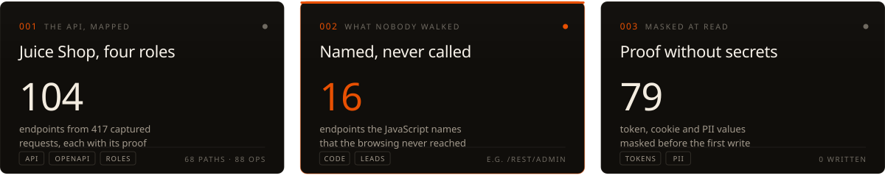

<!-- ─────────────────────────────────────────────────────────────
     proxy2model · README
     The artwork in assets/readme/ is self-contained SVG (Nippo embedded).
     Do not edit it by hand: change scripts/build_readme_svgs.py and run it.
     Links are absolute so the same file renders on PyPI.
     ───────────────────────────────────────────────────────────── -->



### `//` the instrument

Mapping an app by hand takes hours, and it starts over on every engagement: which hosts, pages and
endpoints exist, which page calls what, what the JavaScript names but you never reached, what each
role can see. **proxy2model does that bookkeeping from the traffic you already capture**, so the time
goes to testing. It does not scan or attack, and it never calls anything a vulnerability. It tells
you what is there, which request proves it, and what the capture could not show.

[](https://github.com/falc0n-researcher/proxy2model/blob/main/LICENSE)
[](https://github.com/falc0n-researcher/proxy2model/actions/workflows/ci.yml)
[](#-boundaries)


---

### `//` field test — the bundled capture



Four [OWASP Juice Shop](https://owasp.org/www-project-juice-shop/) sessions (417 requests as anonymous,
user, accounting and admin), modelled in about two seconds on a laptop:

- **001 · The API, mapped** — 104 endpoints, and the observed API as OpenAPI 3.0: 68 paths, 88 operations, ready for Postman, ZAP or a fuzzer.
- **002 · Named, never called** — 16 endpoints the app's JavaScript names but the browsing never reached: `/rest/admin`, `/rest/chat`, `/rest/track-order`, `/api/SecurityAnswers` ...
- **003 · Anonymous got 200 from admin-looking endpoints**, cited to the request:
  ```
  $ proxy2model cross-role juiceshop --low anon --high user
  'anon' reached privileged-looking endpoints (2)
    GET /rest/admin/application-configuration    ev_93  anon=[200] user=[200]
      unknown: whether the low-role response was authorised or a leak · next: compare 'anon' and 'user' response bodies
  ```

Every line cites the request behind it (`ev_93`), and every lead says what is still unknown and the
next safe check. Reproduce it:

```bash
for r in anon user accountant admin; do proxy2model samples/juiceshop-$r.xml -w juiceshop --role $r; done
```

---

### `//` intake

| Traffic from | Command |
| --- | --- |
| Burp (*Save items* XML), Logger++ CSV, Caido (JSON or CSV), or a HAR (browser, ZAP, mitmproxy) | `proxy2model FILE -w app` |
| A browser it opens and records while you use the app | `proxy2model browse` |
| A crawl of a running app | `proxy2model crawl URL -w app --yes` |

Every value is masked as it is read. One model comes out: a report, a SQLite graph you can query,
OpenAPI, and a compact package for an AI. Runs locally.

```bash
pip install proxy2model
```

```bash
proxy2model history.xml -w shop     # build from an export
proxy2model browse                  # or open a browser and use the app (asks for URL, scope, mode)

proxy2model query shop help         # ask the model; answers cite requests, no AI involved
proxy2model mcp --out "$PWD/proxy2model-out"   # or let an AI agent ask (see Using it with an AI)
```

`./demo.sh` builds the bundled sample. `proxy2model` on its own lists the everyday commands;
`proxy2model <command> --help` explains each.

---

### `//` what comes out

```
proxy2model-out/shop/
├── report.html     interactive report: overview, what to check, endpoints, map, every request, query console
├── model.json      the model, and the request behind every claim
├── openapi.json    the observed API, OpenAPI 3.0
├── context.json    what to hand an AI instead of raw traffic
├── graph.db        SQLite graph, queried with `proxy2model q`
├── exports/        graph.json · graph.graphml · build.svg
└── inputs/         masked records of every capture, merged on rebuild
```

---

### `//` boundaries

| It does | It never |
| --- | --- |
| Read traffic you captured | Upload, forward or replay it |
| Mask every value before the first write | Store a token, cookie, key or PII value |
| Say what it could not observe | Claim coverage it did not have |
| Offer hypotheses and the evidence to test them | Call anything a vulnerability |

A plain build is offline. `crawl`, `browse --active` and `osint` send requests of their own: use
them only on systems you are authorized to test. CI plants fake secrets in the samples and fails if
one reaches any output.

---

### `//` field manual

- **01 · [Capturing traffic](https://github.com/falc0n-researcher/proxy2model/blob/main/docs/capture.md)** — Burp, Caido, HAR, `browse`, roles.
- **02 · [Crawling a running app](https://github.com/falc0n-researcher/proxy2model/blob/main/docs/crawling.md)** — `crawl` and scripted journeys.
- **03 · [How it works](https://github.com/falc0n-researcher/proxy2model/blob/main/docs/model.md)** — what is in the model and how it is built.
- **04 · [Querying the model](https://github.com/falc0n-researcher/proxy2model/blob/main/docs/querying.md)** — `query`, BQL, graph reach, diffs between builds.
- **05 · [Using it with an AI](https://github.com/falc0n-researcher/proxy2model/blob/main/docs/ai.md)** — `context.json` and the MCP server.
- **[Skill](https://github.com/falc0n-researcher/proxy2model/tree/main/skill)** — the same method as a playbook for an AI, nothing to install.

<sub>`fa1c0n@recon ~ $` &nbsp; captured traffic in · a model of the app out · every line cited</sub>
