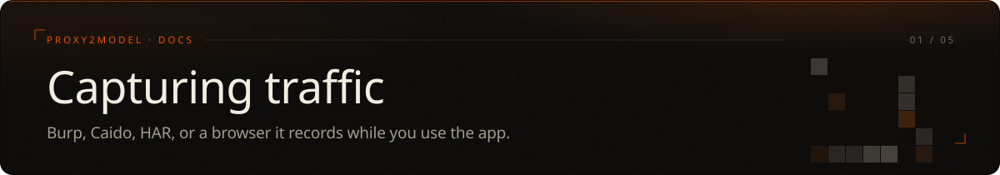

proxy2model reads traffic you already captured, or records your own browser. Only capture traffic you are
authorized to record. Everything runs locally.

---

### `//` Burp Suite

1. Set **Target > Scope** and browse the app through Burp as the role you want to capture.
2. In **Proxy > HTTP history**, select all, right-click, **Save items**. Keep base64 encoding on.

```bash
proxy2model history.xml -w shop
```

Burp Community is enough. A **Logger++ CSV** works too (`--skip-tools Scanner` drops scanner rows).

---

### `//` Caido

In **HTTP History**, **Export**, choose JSON or CSV (*export all*, or *export current rows* to keep
only your filter and scope).

```bash
proxy2model caido-export.json -w shop
```

Each request's `source` works like a Burp tool: `--skip-tools automate` drops Automate traffic,
`--only-tools intercept` keeps only what you browsed. Requests without a response are skipped.

---

### `//` HAR (browser, ZAP, mitmproxy, Hetty, Charles)

```bash
proxy2model session.har -w shop
```

In a browser: DevTools, Network, *Save all as HAR with content*. Requests that never got a response are skipped.

---

### `//` Your own browser

`browse` opens a browser and records what you do in it. The model rebuilds as you go; no proxy,
no export, no certificate to install.

```bash
proxy2model browse
```

It asks for the app's URL, the scope (default `*.<its domain>`: the domain and its subdomains), a
name for the model, the mode, a role, and whether to keep the login:

- **passive** records only what you do.
- **active** also crawls the app in a background tab of the same browser, so it shares your login.
  Because it does, the crawl sends GET only; `--allow-writes` lets through the POST/PUT/DELETE the
  app itself sends. It stays in scope, never clicks logout- or delete-looking controls and never
  submits a password form. Only for apps you are authorized to test.
- **role** (`anon`, `user`, `admin` ...) tags the session, so `cross-role` can compare them.
- **keep the login** (`--keep-login`) keeps the browser profile in
  `~/.config/proxy2model/profiles/<app>[-<role>]`, so the next session starts signed in. It holds
  real cookies, outside the output folder; delete it to log out. Without it the profile is fresh
  and deleted when you finish.

Every tab, popup, frame and worker is recorded from its first request; nothing out of scope is
recorded, and nothing is blocked. Images, fonts and stylesheets are not recorded. A WebSocket is
recorded as its handshake; its messages are counted, not modelled.

Close the window (or Ctrl-C) to finish. The last build lists the endpoints the app's code names that
you have not reached yet (**visit next**) and opens the report (`--no-open` to skip). Each exchange
is masked on arrival and only the masked record is saved (`inputs/browse.jsonl`), so the next
session adds to the same model.

Everything can go on the command line instead:

```bash
proxy2model browse https://app.example.com --scope '*.example.com' -w shop --active --yes --role user
```

Needs Chrome, Chromium, Edge or Brave (found automatically, or `--chrome PATH`).

---

### `//` Roles

Capture once per role, then compare:

```bash
proxy2model user.xml  -w shop --role user
proxy2model admin.xml -w shop --role admin
proxy2model cross-role shop --low user --high admin
```

Rebuilding a role replaces only that role; a build without `--role`, or with `--fresh`, starts over.

`cross-role` sorts every divergence into the authorization question it raises, each with the request
that shows it and a safe next check:

- **privileged-looking reached**: the low role got through to an admin-style path.
- **object reads**: the low role read an object by id. Ask for another account's id as the low role (BOLA).
- **writes**: the low role changed state (POST, PUT, PATCH, DELETE) and got a 2xx.
- **untested**: only the high role tried it. Replay it as the low role.
- **enforced**: 401/403 for the low role, 2xx for the high. The control to compare other replays with.
- **both got 2xx**: compare what each role was shown.

`--json` gives all of it with a `headline` count per intent; long sections stop at 10 unless `--all`.

---

### `//` Keep exporting

`proxy2model watch FOLDER -w shop` builds every new export dropped into the folder and prints what changed.

---

### `//` No proxy

`proxy2model crawl https://shop.example.com/ -w shop --yes` drives a real browser. See [crawling.md](crawling.md).

---

<sub>[field manual](../README.md#-field-manual) &nbsp;·&nbsp; [02 · Crawling a running app →](crawling.md)</sub>
