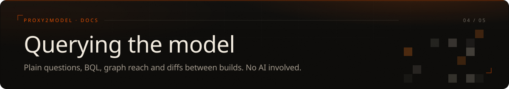

### `//` Plain questions (no AI)

```
$ proxy2model query shop "code vs runtime"
APIs: 10 endpoints
  BOTH         6
  STATIC_ONLY  1
  RUNTIME_ONLY 3
    static-only  * /api/admin/audit  ev_4

Source: Knowledge Graph · Model call: none
```

Every line cites the request behind it. `*` means the code names the path but not the method.

| Intent | Answers |
| --- | --- |
| `list-apis` | every endpoint with state, statuses, evidence |
| `reconcile` | code vs runtime |
| `list-routes` | pages, SPA states, forms |
| `route-apis /x` | APIs a route calls |
| `provenance /api/checkout` | where an endpoint was seen |
| `third-parties` | off-scope hosts |
| `auth-surface` | credentials, roles, cookie flags |
| `unknowns` | what the capture could not answer |
| `entity-evidence <name>` | evidence ids behind any node |

Also: `parameters`, `secrets` (masked), `privileged`, `errors`, `shape`. Anything else is refused: the answer comes from the model or the tool says it cannot. `proxy2model query shop help` lists them.

---

### `//` BQL

`graph.db` holds the whole model. `proxy2model q` queries it with filters and graph verbs:

```bash
proxy2model q shop 'req.method:POST AND resp.code.gte:400'
proxy2model q shop 'node.type:endpoint AND node.state:STATIC_ONLY'
proxy2model q shop 'reach "POST /api/checkout"'
proxy2model q shop 'provenance "POST /api/checkout"'   # every request behind it
proxy2model q shop 'static-only'                        # named in code, never seen in traffic
proxy2model q shop 'changed-since 1'                    # what moved since build 1
proxy2model q shop 'reaches-privileged user'            # admin-looking endpoints a role reached
proxy2model q shop 'sql SELECT type, count(*) FROM nodes GROUP BY type'
proxy2model q shop            # interactive; `help` lists the language
```

Fields are `req.*`, `resp.*`, `node.*`, `edge.*`. Operators: `eq ne cont ncont like regex gt gte lt lte`. Combine with `AND OR NOT ( )`. Values are bound as SQL parameters. The same console is in `report.html`.

---

### `//` Graph reach

```bash
proxy2model graph shop --reach /api/checkout     # entry point -> ... -> the endpoint, as JSON
```

- `--reach NODE`: how a node is reached from an entry point.
- `--blast NODE` / `--touched-by NODE`: what it affects, or what leads into it.
- `--format json|graphml|cypher|reason`: export, or a single package for an AI.

`proxy2model graph shop` alone gives functional areas, trust zones and coupling.

---

### `//` Analyst commands

```bash
proxy2model gaps shop                               # unknowns ranked by value of resolving them
proxy2model changes shop --against old/model.json   # drift by area, never "a bug"
proxy2model builds shop                              # the builds kept in graph.db (label one with --label)
proxy2model diff shop 3 7                            # new workflows, changed fingerprints, gone things
proxy2model falsify shop                            # prompt that tries to disprove each hypothesis
proxy2model methodology shop [--prompt]             # target-specific plan, or the AI prompt for it
```

#### What changed between builds

Every build is kept in `graph.db`. `diff` compares two of them (by default the last two). Abridged, from the two bundled samples:

```
shop: build 1 (2026-11-02) → build 2 (2026-11-02)
  1 new workflow(s) · 3 new · 4 changed · 7 gone · 4 removed workflow(s)

NEW WORKFLOWS (connected additions, one line each)
  ▸ route shop.example.com/admin  (4 things: 1 endpoint, 2 parameters)
      shop.example.com/admin → POST /api/admin/users → +2 parameters

CHANGED
  ~ GET /api/admin/users  [endpoint]
      statuses 403 → 200
      ev_3
```

A new page, the script it loads, the endpoint that script names and its parameters are one line, not a dozen. The same build twice gives no drift. In BQL, `node.first_build` and `node.last_build` (also `first_seen`, `last_seen`) say when a thing first and last appeared. Set `PROXY2MODEL_KEEP_BUILDS=N` to keep only the newest N builds.

To build as you go, save each export into one folder and run `proxy2model watch FOLDER -w shop`. Every new export becomes a build named after its file, and the change from the last build prints. Works with Burp Community.

All results are hypotheses to verify in an authorized session. The same five analyst roles are in the [`skill/`](../skill/) playbook. A sample report is in [`examples/juiceshop/report.html`](examples/juiceshop/report.html).

---

<sub>[← 03 · How it works](model.md) &nbsp;·&nbsp; [field manual](../README.md#-field-manual) &nbsp;·&nbsp; [05 · Using it with an AI →](ai.md)</sub>
